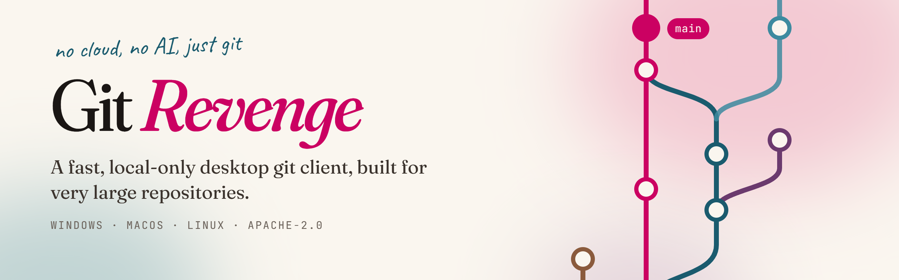

<picture>
  <source media="(prefers-color-scheme: dark)" srcset="https://raw.githubusercontent.com/Git-Revenge/.github/main/profile/banner-dark.png">
  
</picture>

Git Revenge is a desktop git client for Windows and macOS that stays fast on huge repositories. It drives the `git` you already have installed. There are no accounts, no cloud features and no AI.

**[Download the latest release](https://github.com/Git-Revenge/GitRevenge/releases/latest)** · [Read the docs](https://gitrevenge.com) · [Browse the source](https://github.com/Git-Revenge/GitRevenge)

### Why use it

- **It copes with very large repositories.** On the Linux kernel (1.5M commits), the first screen of the graph arrives in under half a second.
- **It uses your setup.** Your git config, credential helpers and SSH agent all work as they already do.
- **It stays on your machine.** There's no telemetry and no sync. The only request it makes on its own is a check for a newer release at startup, and you can turn that off.

### Get involved

Git Revenge is in early development. Bugs and ideas go in the [issue tracker](https://github.com/Git-Revenge/GitRevenge/issues). Before you open a pull request, read the [contributing guide](https://github.com/Git-Revenge/GitRevenge/blob/main/CONTRIBUTING.md) and the [code of conduct](https://github.com/Git-Revenge/GitRevenge/blob/main/CODE_OF_CONDUCT.md). Report vulnerabilities privately, as the [security policy](https://github.com/Git-Revenge/GitRevenge/blob/main/SECURITY.md) explains.

Licensed under [Apache-2.0](https://github.com/Git-Revenge/GitRevenge/blob/main/LICENSE).
